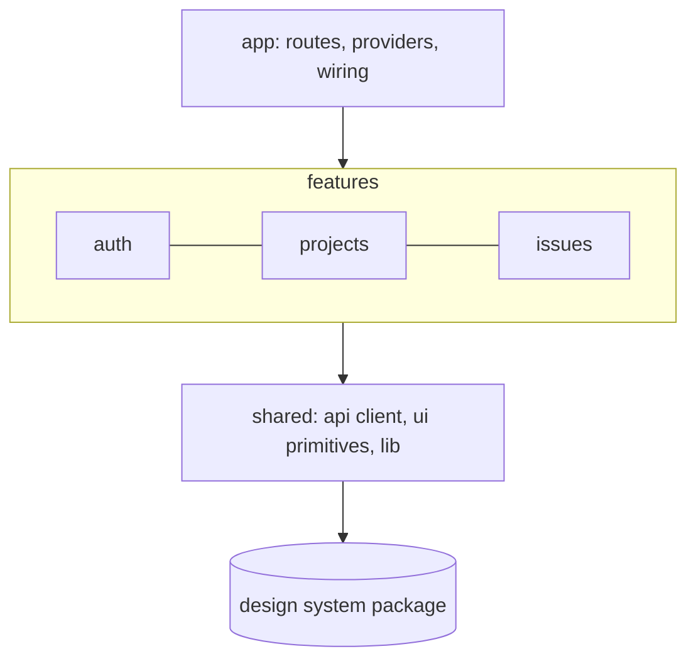

# 01 · Architecture of a large frontend application

## Question

How do you keep a 50-developer, multi-year React codebase changeable?

## Principles

1. **Organise by feature, not by file type.** The unit of change is a feature; the folder should match.
2. **One-way dependencies.** `app → features → shared`. Cycles are the early sign of a big ball of mud.
3. **Public API per module.** Other code imports `features/billing`, never `features/billing/internal/x`. Enforce with lint (`no-restricted-imports`, or `eslint-plugin-boundaries`/Nx module boundaries), because conventions that are not checked decay.
4. **Separate server state from client state.** Most "global state" is cached server data; use a query cache for it and keep real client state small.
5. **Composition root.** Wiring (API ↔ auth, error reporter, feature flags) happens in one place so the rest of the code stays testable.

## Failure modes

| Smell | Cause | Remedy |
|---|---|---|
| Any change touches many folders | layer-based structure | move to feature folders |
| Feature A imports B's internals | no enforced boundary | lint rule + promote shared bits to B's public API |
| `utils/` grows forever | no ownership | move to the feature that uses it; keep `shared/` domain-free |
| Global store holds API data | missing query cache | adopt query library; invalidate instead of syncing |

## Worked example

[`enterprise-react-app`](https://github.com/smrafi4130/enterprise-react-app) implements this; see its ADR-0001 and ADR-0002. During development the boundary lint rule caught a real violation (`users` importing from `auth/schemas`), which was resolved by exporting `userSchema` from `auth`'s public API.
