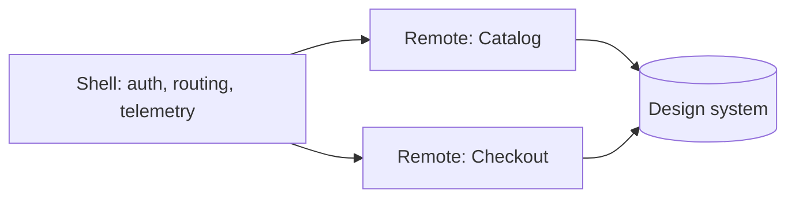

# 02 · Micro-frontends vs modular monolith

## Question

Should multiple teams ship independent frontends, or share one deployable?

## What micro-frontends buy and cost

| | Modular monolith | Micro-frontends |
|---|---|---|
| Deploy independence | One pipeline; coordinated releases | Per-team releases |
| Team autonomy | High within repo rules | Highest (own stack, cadence) |
| Runtime cost | One bundle graph, shared deps deduped | Duplicate frameworks risk, extra network hops, integration code |
| Consistency (UX, a11y, perf) | Easy to enforce centrally | Needs a shared design system and contracts; drifts without them |
| Cross-cutting state (auth, routing) | Trivial | Needs explicit contracts (events, shared shell) |
| Operational complexity | Low | Version skew, independent failures, harder local dev |

## Integration options

- **Build-time (npm packages):** simple, but not independently deployable.
- **Runtime via Module Federation / import maps:** independent deploys, shared deps negotiated at runtime.
- **Iframes / web components at the edge:** strong isolation, weak UX integration.
- **Server-side composition (edge includes):** good for content pages.

## Decision rule

Start with a **modular monolith with enforced boundaries** (see case study 01). Move to micro-frontends only when *organisational* pressure is real: teams blocked on each other's release train, or genuinely different release cadences or stacks. Technical modularity alone does not justify the runtime and operational cost.

If you split, mitigate first: shared design system (versioned), a contract for shell↔remote (routing, auth, telemetry), pinned shared-dependency policy, and per-remote performance budgets.

## Status

Analysis only; I have not built a federated system in this portfolio, and the modular-monolith side is the one demonstrated in code.
