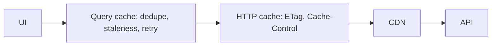

# 04 · Data fetching and caching

## Layers

## Patterns

- **Stale-while-revalidate** at the query layer: show cached data immediately, refresh in the background. Tune `staleTime` per resource (profile data: minutes; stock prices: seconds).
- **Deduplication:** components request what they need; the cache collapses identical in-flight requests.
- **Invalidation over manual sync:** after a mutation, invalidate affected keys and refetch. Keep keys co-located with queries so affected keys are discoverable.
- **Optimistic updates** for actions users expect to be instant. Requires: snapshot, apply, rollback on error, reconcile with the server after settle.
- **Pagination:** cursor-based for feeds that change; offset only for static sets.
- **Request cancellation:** pass `AbortSignal` so navigation does not leave stale responses racing in.
- **Retry policy:** retry network errors, 5xx and 429 with backoff; never retry 4xx.
- **Runtime validation at the boundary** (Zod or similar): TypeScript types do not exist at runtime, so a backend change otherwise surfaces as a confusing crash deep in a component.

## Normalised vs document caches

Query-keyed caches (TanStack Query, SWR) are simple and cover most apps. Normalised caches (Apollo, Relay) give automatic cross-query consistency for graph-shaped data, at the cost of schema coupling and complexity. Choose normalised only when the same entity is displayed and edited in many places.

## Example

`enterprise-react-app/src/features/issues/queries.ts` implements optimistic update with rollback and cross-key invalidation; its integration test forces a 500 to prove the rollback.
