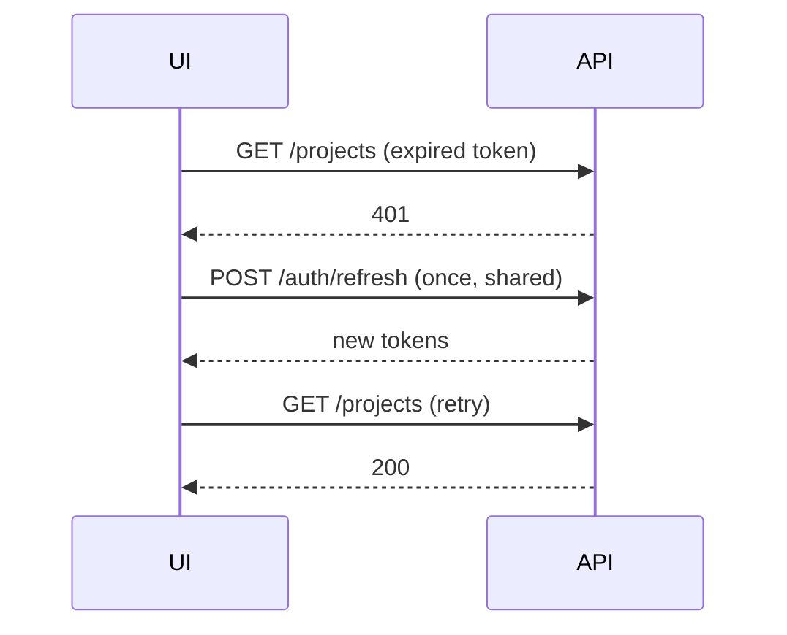

# 06 · Authentication and frontend security

## Where to keep tokens

| Option | XSS exposure | CSRF exposure | Notes |
|---|---|---|---|
| `localStorage` | Token readable by any script | None | Persistent; worst for XSS |
| Memory only | Not persisted, harder to steal long-term | None | Lost on reload; pair with refresh |
| `httpOnly; Secure; SameSite` cookie | Not readable by JS | Needs SameSite + CSRF token for unsafe methods | Recommended default for first-party apps |

**Recommended:** short-lived access token in memory, refresh token in an httpOnly cookie, refresh endpoint protected against CSRF. Backend-for-frontend (BFF) keeps tokens off the browser entirely.

## Refresh flow

Single-flight: concurrent 401s share one refresh, because rotating refresh tokens invalidate on reuse. Retry the original request once. Never refresh from auth endpoints (avoids loops). On failure, clear session and redirect with return URL.

## Authorization

Treat UI checks as affordances, not security: hide what a user cannot do, but the server enforces every rule. Model permissions (`issue:update`), not role names, in components.

## XSS, CSP, supply chain

- Default React escaping covers most cases; the risks are `dangerouslySetInnerHTML`, `href="javascript:"`, and unsanitised rich text (sanitise with DOMPurify).
- **CSP:** no `unsafe-inline` scripts, use nonces or hashes; `frame-ancestors` for clickjacking; Trusted Types where supported.
- Lock dependencies, review postinstall scripts, use Subresource Integrity for third-party scripts, minimise third-party tags.
- Validate redirects (`returnTo`) against an allow-list to prevent open redirects.

## Example

`enterprise-react-app` implements the memory + sessionStorage variant and documents why it is a compromise (ADR-0003).
