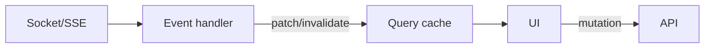

# 07 · Real-time frontend architecture

## Transport choice

| | Polling | SSE | WebSocket |
|---|---|---|---|
| Direction | client pull | server → client | bidirectional |
| Infra friendliness | best | good (plain HTTP, auto-reconnect) | needs sticky/upgrade support |
| Use when | low-frequency freshness | notifications, feeds, progress | chat, collaboration, presence |

Start with the simplest that meets the latency need; many "real-time" requirements are fine with 10-30 s polling or SSE.

## Client design

- **Treat events as cache updates**, not as a second source of truth: on message, patch or invalidate the relevant query keys.
- **Reconnect with exponential backoff and jitter**; resume from a last-event id or refetch to close the gap.
- **Heartbeat / visibility:** pause on hidden tabs, resync on focus.
- **Ordering and idempotency:** carry version numbers; ignore stale events.
- **Optimistic UI + server reconciliation** for user actions; show the pending state.
- **Backpressure:** batch UI updates (e.g. one render per animation frame) when the event rate is high.

## Failure handling

Surface connection state to users, degrade to polling if the socket is blocked, and cap retries.

## Status

Design note only; not yet implemented in a project here.
